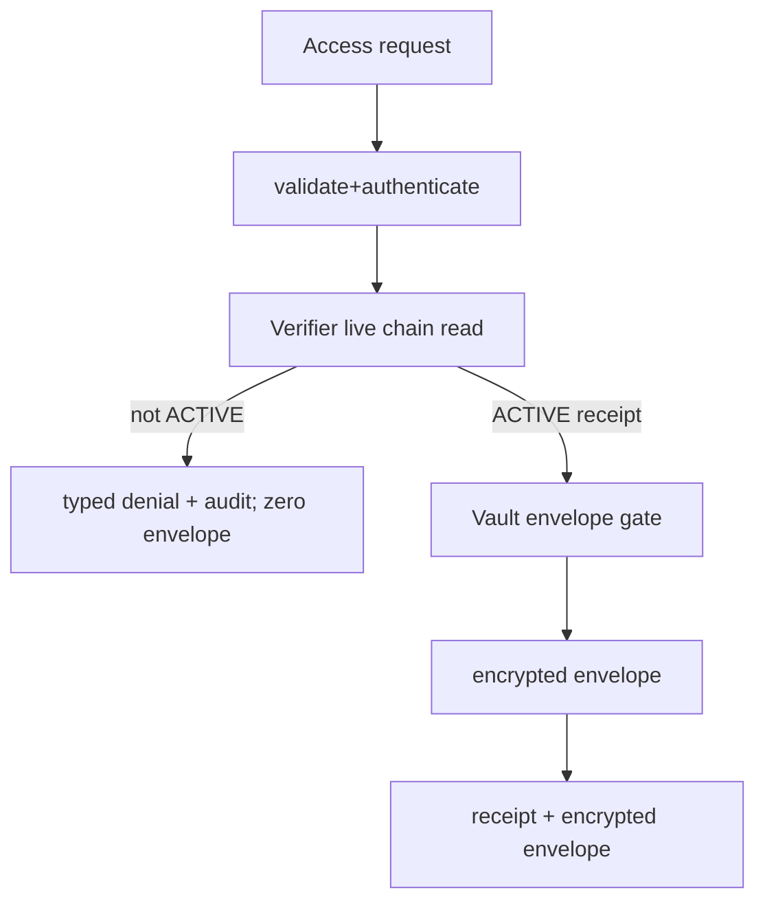

# Continuity Service

> Feature spec for implementation planning. Source: `../tech-design.md` §8–10.

| Field | Value |
|---|---|
| Component | continuity-service |
| Priority | P0 |
| Upstream Refs | HACK-001-02 §4–7 |
| Depends On | crypto-vault, verifier-sdk |
| Blocks | owner-web, agent-b |

## Purpose

提供 encrypted package/grant envelope、consent transaction preparation 与 access API，强制 verify-before-envelope；永不接收或生成明文。

## Scope

Included：encrypted-only REST、zod validation、owner/grantee 与 P-256 key binding、幂等、事务、审计。Excluded：decrypt/unwrap/context/model、代签链交易、明文 content 字段。

## Core Responsibilities

编排 Create/Change/Access/Revoke prepare、typed errors、request receipts、denial invariants、synthetic-only gate。

## Interfaces

```ts
createPackage(cmd:CreatePackageCommand):Promise<PackageCreated>;
createVersion(cmd:CreateVersionCommand):Promise<VersionCreated>;
storeGrantEnvelope(cmd:StoreGrantEnvelopeCommand):Promise<EnvelopeStored>;
prepareConsent(cmd:PrepareConsentCommand):Promise<TxRequest>;
requestAccess(cmd:AccessRequestCommand):Promise<AccessDecision>;
```

HTTP contracts and all codes are normative in main design §9/§7.7.

## Data Flow



## Key Behaviors

Mutation idempotency is key+request hash. Create/version endpoints reject any `content` field and store only browser-encrypted bytes plus opaque `protocolVersion/versionId/supersedesVersionId/recordedAt/provenanceCommitment` metadata. Grant endpoint verifies grantee signature over P-256 public-key binding and commitment consistency without decryption；它不判断材料真假或来源权威。Access metrics expose envelope returns; service-wide instrumentation asserts `server_plaintext_count=0`. DB consent_refs is display cache only.

## Constraints

30 req/min/grantee; 2 s chain deadline; request body ≤300 KiB; API v1 additive compatibility; no content in logs/traces/idempotency response for access requests.

## Acceptance Criteria

| AC-ID | Priority | Criterion | Expected Result | Verification Method |
|---|---|---|---|---|
| AC-SVC-001 | P0 | browser-encrypted Create/version valid | immutable ciphertext rows and prepared chain tx | integration |
| AC-SVC-002 | P0 | all denial outcomes | exact 4xx; envelope return zero | table-driven integration |
| AC-SVC-003 | P0 | duplicate key same/different body | replay / `IDEMPOTENCY_CONFLICT` | concurrency test |
| AC-SVC-004 | P0 | two concurrent version writers | one commits, one `VERSION_STALE` | DB integration |
| AC-SVC-005 | P1 | RPC timeout/circuit open | 503 fail-closed, no DB plaintext read | fault injection |
| AC-SVC-006 | P0 | plaintext content field or invalid Agent key binding | reject schema/403; no storage/envelope | negative integration |
| AC-SVC-007 | P0 | instrument all endpoints | `server_plaintext_count=0`; no decrypt/unwrap/model dependency | architecture/security test |
| AC-SVC-008 | P0 | protocol/provenance commitment or version chain metadata malformed | typed reject before storage；no row/envelope | schema + mutation integration |

## Error Handling

Use catalog §7.7, never contract raw revert/SQL/stack. Middleware adds requestId and maps only known domain errors; unknown faults sanitized 500 internally (not advertised contract), with no retry that might bypass guard.

## File Structure

```text
apps/api/src/{server.ts,routes/packages.ts,routes/consents.ts,routes/access.ts,application/access-service.ts,middleware/error.ts}
apps/api/test/{packages.integration.test.ts,access-matrix.integration.test.ts,idempotency.test.ts}
```

## Test Module

**Test file:** `apps/api/test/access-matrix.integration.test.ts`. Run real SQLite+Anvil+Verifier+Vault; assert only ACTIVE returns encrypted envelope, every denial returns none, post-revoke fresh request is blocked, and server plaintext/decrypt/model counters remain zero.
