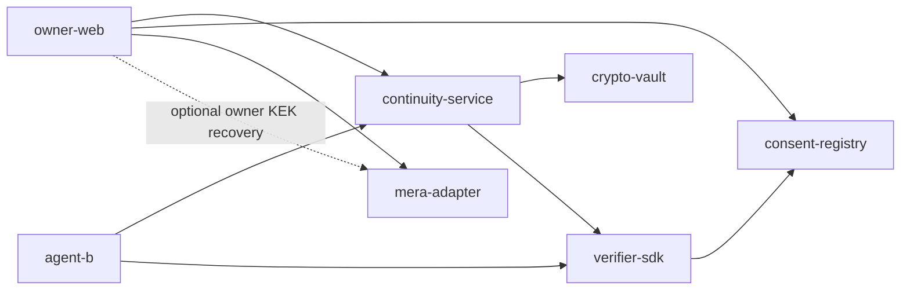

# Shanhai Continuity Component Specs

> Source: `../tech-design.md` §8.1. Ordering is defined only here.

| # | Component | Priority | Depends on | Execution gate |
|---:|---|---|---|---|
| 1 | `consent-registry` | P0 | Monad | Foundry invariants pass |
| 2 | `verifier-sdk` | P0 | consent-registry | five-state matrix passes |
| 3 | `mera-adapter` | P1 | official SDK/browser | TP-MERA-01; failure disables claim, not core access |
| 4 | `crypto-vault` | P0 | — | encrypted-only repository tests pass |
| 5 | `continuity-service` | P0 | vault, verifier | deny-before-envelope; server plaintext zero |
| 6 | `owner-web` | P0 | service, registry, adapter | Create/Change/Revoke E2E |
| 7 | `agent-b` | P0 | service, verifier | independent-origin Continue/E2E |

All specs inherit: synthetic-only; no production/payment; service/Vault never see plaintext or CEK/SPK; only ACTIVE returns an encrypted envelope; Agent B decrypts locally; denied requests have zero envelope/local-decrypt/model calls; Mera is P1 recovery, not a P0 access gate. All plaintext payloads conform to SCP 0.1.0: preserve `originKind` + `reviewStatus`, deterministic authority rank, `validTime` + `recordedAt`, and immutable supersession relations. Scope projection MUST preserve these fields and MUST exclude `USER_REJECTED` items.
