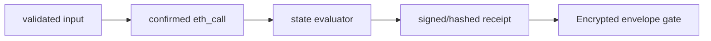

# Verifier SDK

> Feature spec for implementation planning. Source: `../tech-design.md` §8.

| Field | Value |
|---|---|
| Component | verifier-sdk |
| Priority | P0 |
| Upstream Refs | HACK-001-02 §4.4, §5.2, §7 |
| Depends On | consent-registry |
| Blocks | continuity-service, agent-b |

## Purpose

独立读取 Monad，并把持久 `ISSUED/REVOKED` 与请求事实解释为 `ACTIVE | SCOPE_MISMATCH | VERSION_STALE | REVOKED | EXPIRED | NOT_FOUND`。

## Scope

Included：viem read、canonical scope hash、finality、状态判定、receipt。Excluded：读取/解密 Vault、模型调用、信任 DB consent cache。

## Core Responsibilities

实时读链、固定 guard precedence、fail-closed、typed result、无敏感日志。Verifier 只证明授权状态和 commitment 绑定，不判断材料内容、来源真假或用户确认质量。

## Interfaces

```ts
type ConsentOutcome = 'ACTIVE'|'SCOPE_MISMATCH'|'VERSION_STALE'|'REVOKED'|'EXPIRED'|'NOT_FOUND';
type VerifyInput = { chainId:number; registry:`0x${string}`; consentId:`0x${string}`; assetId:`0x${string}`; grantee:`0x${string}`; version:number; requestedScopes:string[]; requestDigest:`0x${string}` };
type VerificationReceipt = { outcome:ConsentOutcome; consentId:string; requestDigest:string; blockNumber:bigint; blockHash:string; checkedAt:number; expiresAt:number };
export interface ConsentVerifier { verify(input:VerifyInput, signal?:AbortSignal):Promise<VerificationReceipt>; }
```

## Data Flow



## Key Behaviors

Read asset and consent at one confirmed block. Missing/grantee mismatch → NOT_FOUND；revoked → REVOKED；time elapsed → EXPIRED；version mismatch → VERSION_STALE；request/grant scope binding mismatch → SCOPE_MISMATCH；only then ACTIVE. Outcome is derived, never persisted. Receipt TTL 10 seconds and binds requestDigest/block hash/public-key fingerprint.

## Constraints

No cross-request ACTIVE cache; two retry limit then `CHAIN_UNAVAILABLE`; exact ABI hash pinned; all scope canonicalization shared with issuance.

## Acceptance Criteria

| AC-ID | Priority | Criterion | Expected Result | Verification Method |
|---|---|---|---|---|
| AC-VER-001 | P0 | exact current agent/scope/version | ACTIVE receipt at confirmed block | Anvil integration |
| AC-VER-002 | P0 | each mismatch/revoked/absent state | exact distinct outcome | table-driven test |
| AC-VER-003 | P0 | RPC unavailable/reorged block | typed 503, never ACTIVE | fault injection |
| AC-VER-004 | P0 | receipt replay with changed request/key/provenance commitment/after TTL | envelope gate rejects | integration |
| AC-VER-005 | P1 | scope order/duplicates vary | canonical hash deterministic; duplicate input rejected | property test |

## Error Handling

Invalid input maps 400/422; state denial is typed 403/404/409; transport failure is retryable 503. Raw RPC details are logged only as sanitized codes.

## File Structure

```text
packages/verifier-sdk/src/{index.ts,verifier.ts,evaluator.ts,scope.ts,receipt.ts,errors.ts}
packages/verifier-sdk/test/{verifier.integration.test.ts,evaluator.test.ts,receipt.test.ts}
```

## Test Module

**Test file:** `packages/verifier-sdk/test/verifier.integration.test.ts`. Assert the complete matrix, exact block binding, finality, retry budget, circuit opening, canonical scope and no cache-after-revoke.
