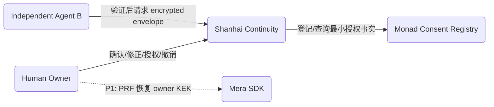
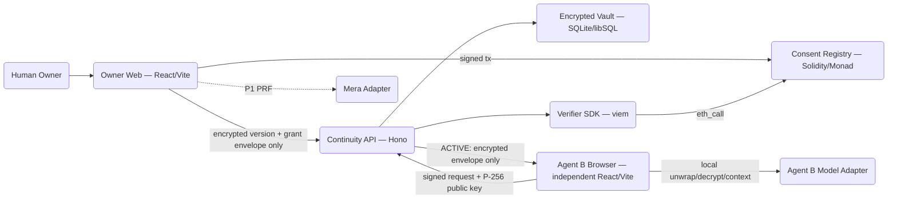
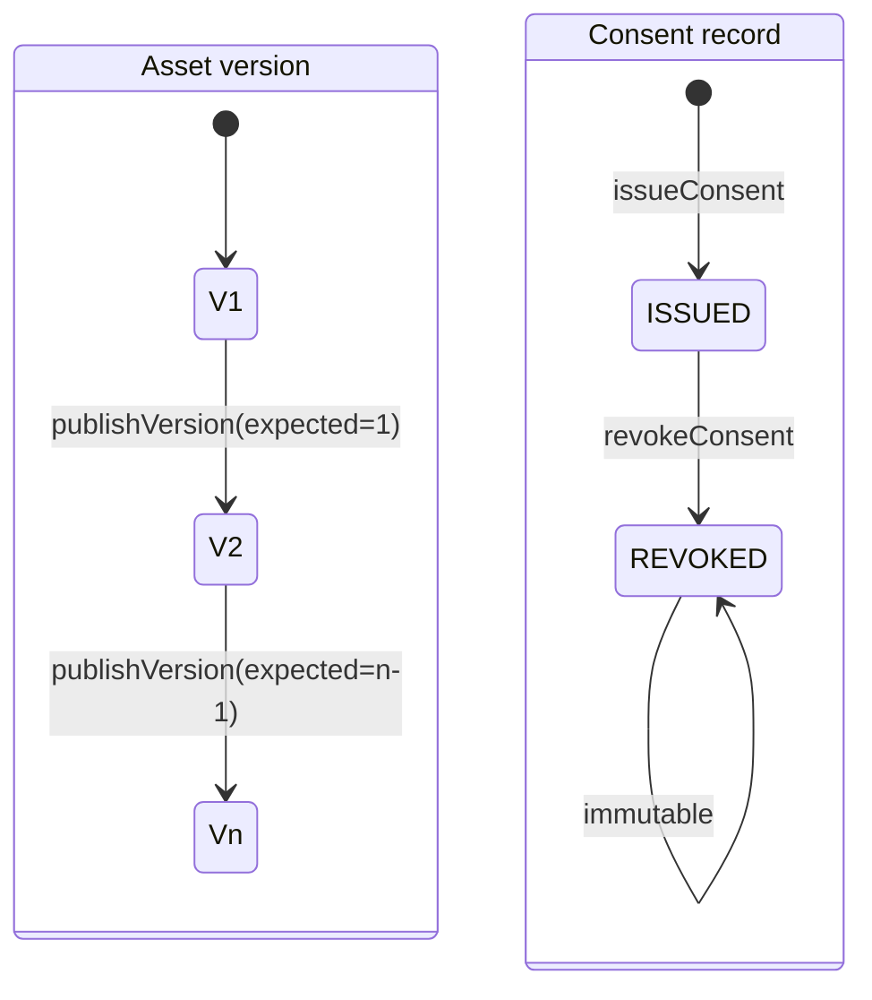
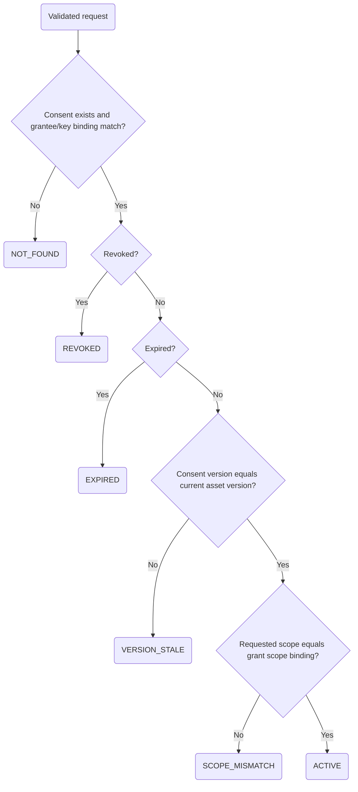
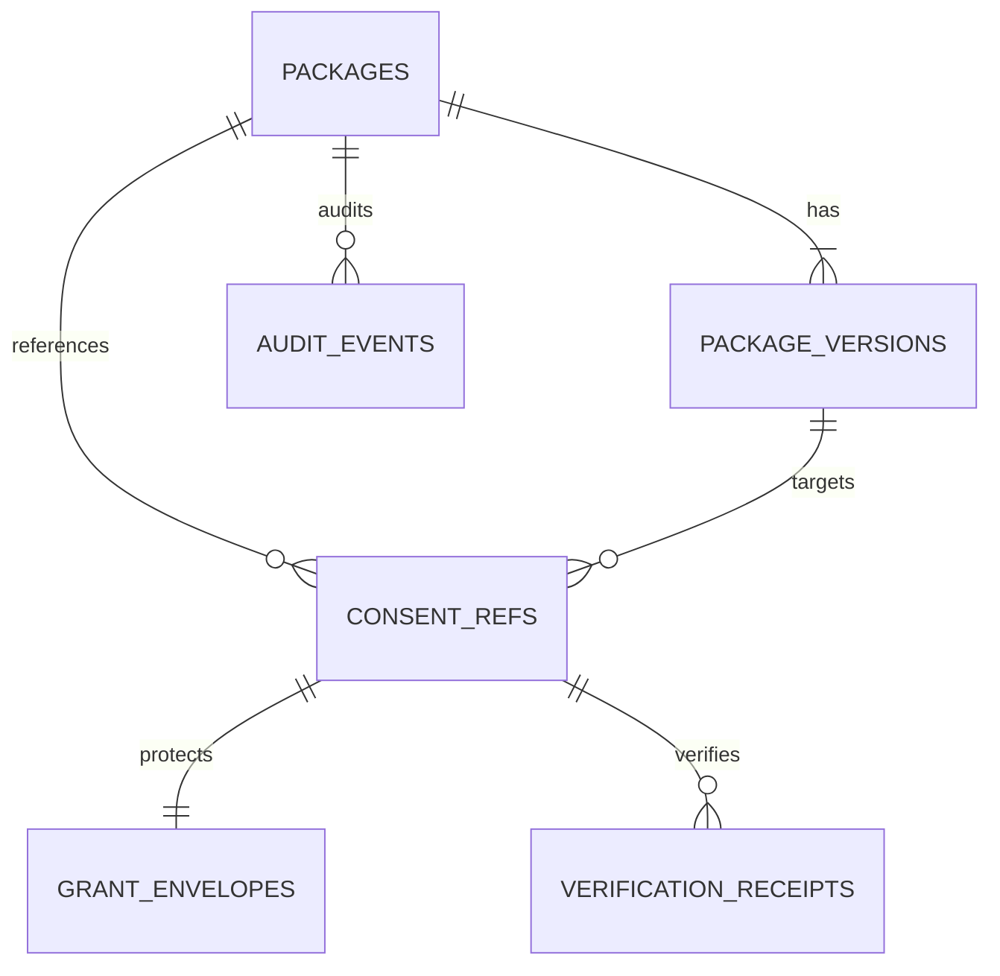

# HACK-001-03｜Shanhai Continuity 协议与系统技术设计

## 1. Document Information

| Field | Value |
|---|---|
| Version | 0.2.0-draft |
| Date | 2026-09-21 |
| Status | Draft / implementation blueprint |
| Author | 未叙山海（单人参赛） |
| Reviewer | 外部盲评者与赛前红队（待执行） |
| Upstream | `HACK-001-02_参赛产品需求与冻结范围_v1.0.md`（唯一范围合同） |
| Repository profile | Greenfield clean-room；尚无代码；synthetic-only |
| Internal deadline | 2026-10-12 |

## 2. Revision History

| Version | Date | Change |
|---|---|---|
| 0.1.0 | 2026-09-21 | 初稿：架构、协议、API、数据、安全、验证与组件 specs |
| 0.2.0 | 2026-09-21 | 接入 SCP 0.1.0、来源/确认优先级、双时间与不可变修正关系 |

## 3. Overview

### 3.1 Background

Shanhai Continuity 证明“记忆可迁移，权威仍属于人”：Human Owner 确认合成资料后形成版本化 Continuity Package；正文只以密文离链保存；Monad Consent Registry 只保存独立验证所需的最小授权事实；独立 Agent B 在读取正文、解密或构造模型上下文之前，必须用 Verifier SDK 验证 grantee、scope、version 与状态。

### 3.2 Goals

- 完成 Create → Continue → Change → Revoke 四幕、三分钟内可连续复现的真实闭环。
- 新版本使旧版本授权真实 `VERSION_STALE`；撤销使后续新请求真实 `REVOKED`。
- Owner Web 用 AES-256-GCM 加密正文；服务端永不获得 owner plaintext/CEK。每次 grant 由 Owner Web 生成最小 disclosure、随机 SPK，并用 Agent B P-256 ECDH 公钥派生的 wrapping key 包裹 SPK。
- Monad 成为不可移除的 consent truth layer；Agent B 为独立进程/应用。
- 单人可在 2026-10-12 前实现、测试、部署、复现；仅使用合成数据。
- 以独立、版本化 `Shanhai Continuity Protocol` 表达可迁移材料，并通过公开一致性向量验证来源、时间和修正规则。

### 3.3 Non-Goals

真人/生产数据、生产迁移、支付、钱包用途的 Mera、NFT/Token、数据交易、多链、DID 大体系、ZK、诊断、长期自动召回、完整未叙网站及“市场验证”声明均不在范围。撤销不承诺删除第三方已合法取得的明文。

### 3.4 Scope

包含 schema、确认/修正、版本、范围授权、合约、Verifier SDK、独立 Agent B、离链密文、Mera PRF 兼容性探针、状态阻断、测试与部署说明。生产系统、真人材料和非核心 sponsor 集成排除。

### 3.5 User Scenarios

| ID | Type | Persona / Goal | Steps | Machine-verifiable success |
|---|---|---|---|---|
| SC-01 | Human | Owner 创建 V1 | 输入合成材料→Agent A 整理→修改→确认→授权 | 密文落库；链上事件含 commitment/scope/version，不含正文 |
| SC-02 | Agent | 独立 Agent B 接续 | 请求 package/version/scope→Verifier 查链→服务端返回密文包络→B 浏览器本地解包/解密/构造 context | `ACTIVE` 才返回 envelope；服务端 plaintext count 恒为 0 |
| SC-03 | Human+Agent | Owner 创建 V2 后阻断旧授权 | V2 supersedes V1→Agent B 重放 V1 授权 | `VERSION_STALE`；零 envelope、零本地解密/模型调用 |
| SC-04 | Human+Agent | Owner 撤销 | revoke 交易确认→新请求 | `REVOKED`；零 envelope、零上下文 |
| SC-05 | Human | 跨设备恢复候选 | 新浏览器/第二设备用同一 passkey PRF 恢复 KEK | 若兼容探针通过，可解包同一 CEK；否则 bounty 宣称关闭 |

### 3.6 Acceptance Criteria

| AC-ID | Priority | Criterion | Expected result | Verification |
|---|---|---|---|---|
| AC-001 | P0 | 确认 V1 并授权 | 链上仅最小事实，Vault 仅密文 | E2E + chain event assertion |
| AC-002 | P0 | ACTIVE 且 agent/scope/version 全匹配 | API 仅返回绑定的 encryptedEnvelope；B 浏览器本地解密 | Integration + browser E2E |
| AC-003 | P0 | scope 超出授权 | 403 `SCOPE_MISMATCH`；零 envelope/本地解密/模型调用 | Negative integration |
| AC-004 | P0 | 创建 V2 后请求旧授权 | 409 `VERSION_STALE`；零 envelope | Contract + E2E |
| AC-005 | P0 | revoke 确认后发起新请求 | 403 `CONSENT_REVOKED`；零 envelope/上下文 | Contract + E2E |
| AC-006 | P0 | 无授权或错误 grantee | 404 `CONSENT_NOT_FOUND`；零正文 | Negative integration |
| AC-007 | P0 | 相同 idempotency key 重试创建/授权/撤销 | 不产生重复版本或副作用，返回首次结果 | Integration |
| AC-008 | P0 | grant 密文/标签/AAD 被篡改 | Agent B 本地解密失败 `CIPHERTEXT_INTEGRITY_FAILED`；不构造 context | Browser unit/property |
| AC-009 | P1 | Mera PRF API/跨设备能力不兼容 | adapter probe 失败且关闭 Mera feature/bounty claim，不降级存秘密 | Compatibility probe |
| AC-010 | P1 | 陌生开发者按 README 复现 | 30 分钟内本地运行测试与四幕脚本 | Blind reproduction |
| AC-011 | P0 | 任意链上 payload 扫描 | 不含正文、姓名、情绪或可识别字段 | Privacy test |
| AC-012 | P1 | Monad RPC 暂时失败 | fail-closed；503 `CHAIN_UNAVAILABLE`；不读正文 | Fault injection |
| AC-013 | P0 | 检查 API/DB/log/process instrumentation | `server_plaintext_count=0` 且无 CEK/SPK/private key | Security integration |
| AC-014 | P0 | grantee 签名绑定的 P-256 公钥不匹配 | 403 `AGENT_KEY_BINDING_INVALID`；零 envelope | Signature-binding test |
| AC-015 | P0 | SCP 0.1.0 正反测试向量 | 来源/确认、双时间、跨版本修正全部按规范接受或拒绝 | Protocol conformance suite |
| AC-016 | P0 | disclosure 投影或传输后核验 | provenance 与双时间字段完整，commitment 一致；`USER_REJECTED` 不进入上下文 | Integration + mutation test |

### 3.7 Success Metrics

| Metric | Baseline | Target | Measurement |
|---|---|---|---|
| 四幕连续完成率 | 无 | 10/10 次无人工修复 | scripted E2E |
| stale/revoke 泄漏率 | 无 | 0/1000 请求返回正文或触发模型 | counter + fault tests |
| 本地验证 p95（不含链确认） | 无 | ≤800 ms warm RPC | benchmark |
| ACTIVE 门禁正确率 | 无 | 100% 状态矩阵 | deterministic integration suite |
| 陌生人复现 | 无 | ≥4/5 在 30 分钟内成功 | blind review record |
| 链上敏感字段 | 无 | 0 | ABI/event inspection |

## 4. System Context



信任边界：浏览器、API、Vault DB、Agent B、Monad RPC、Mera SDK 相互不默认信任。链上状态是授权真相；密文存储不是授权真相；服务端缓存不可覆盖最新 revoke/stale。

## 5. Solution Design

### 5.1 Solution A (Recommended): TypeScript vertical slice + Solidity Registry

pnpm monorepo；React/Vite 两个独立应用（Owner Web 与 Agent B）；Hono/Node API；Solidity/Foundry；viem；SQLite/libSQL；共享 zod/schema 包。API 负责编排，但 Verifier 独立包直接读 Monad。优点是构建面小、浏览器边界清晰、两个独立 app 可被演示和测试证明；缺点是需自行组织 API 与部署。

### 5.2 Solution B: Next.js full-stack + Hardhat + Postgres

Next.js 可快速做页面和 route handlers，Postgres 更接近生产，Hardhat 与 TS 统一；但 server/client 边界在单一应用内更容易让“独立 Agent B”变成视觉伪装，冷启动与部署复杂度增加，单人截止期收益不足。

### 5.3 Solution C: Event/indexer-first microservices

独立 indexer、队列、Postgres、多个服务可增强链事件查询与扩展性，但在 demo 负载下增加最终一致性和运维失败面；revoke 不能依赖滞后 indexer，因此不选。

### 5.4 Comparison Matrix

| Criterion | Weight | A | B | C |
|---|---:|---:|---:|---:|
| 截止期/单人可交付 | 30% | 5 | 4 | 2 |
| 独立 Agent B 可证明性 | 25% | 5 | 3 | 5 |
| revoke 强一致门禁 | 20% | 5 | 4 | 3 |
| 测试/类型共享 | 15% | 5 | 5 | 4 |
| 运维简洁 | 10% | 5 | 3 | 1 |
| 加权结论 | 100% | **5.0** | 3.8 | 3.1 |

决策：选 A。SQLite/libSQL 而非 Postgres，因为仅合成演示、单写者、可携带复现；所有持久化接口保持 repository abstraction，未来不承诺迁移。React/Vite 而非 Next.js，以物理独立应用明确证明 Agent B 不与 Owner UI 共进程。

## 6. Architecture Design



依赖方向：apps → domain/application ports → adapters；`crypto-vault` 不导入 UI 或 chain 实现；`verifier-sdk` 不导入 Vault；Agent B 不接触 DB。所有授权路径 fail-closed。

## 7. Technology Stack & Conventions

### 7.1 Technology Stack Decision

| Layer | Choice | Version policy | Rationale |
|---|---|---|---|
| Language/runtime | TypeScript / Node.js | Node 24 LTS；TS 5.x 锁文件固定 | Mera 0.2.0 要求 Node >=24；单语言、Web Crypto、viem 生态 |
| Package/build | pnpm workspace + Turborepo | pnpm 10.x；精确 lock | 单人增量构建与包边界 |
| Owner/Agent B UI | React 19 + Vite 7 | 实现时固定补丁版 | 独立 apps、快启动、无伪装 B |
| API | Hono 4 + zod | 实现时固定 | 小、Web 标准 Request/Response |
| Contract | Solidity 0.8.30 + Foundry | solc 精确固定 | fuzz/invariant 与部署脚本 |
| Chain client | viem 2.x | 精确 lock | ABI 类型安全、轻量 |
| Data | SQLite 3 / libSQL adapter | schema migration 固定 | 可复现、演示低负载 |
| Crypto | WebCrypto AES-GCM + P-256 ECDH/HKDF | TP-CRYPTO-02：Node 25、Chrome 153、Edge 153 合成 PASS | 标准 WebCrypto；避免未核实 X25519 |
| Test | Vitest, Playwright, Foundry | lockfile | unit/integration/E2E/contract |

### 7.2 Naming Conventions

文件 `kebab-case.ts`；类型/组件 `PascalCase`；函数变量 `camelCase`；常量 `UPPER_SNAKE_CASE`。API `/api/v1/{plural-nouns}`、JSON `camelCase`、UUID 小写；DB 表/列/index `snake_case`。Solidity contract/event `PascalCase`，function `camelCase`，custom error `PascalCase`。

### 7.3 Parameter Validation & Input Parsing

| Input | Type | Rules / limit | Default | Error |
|---|---|---|---|---|
| packageId | UUID | v4, lowercase | none | `INVALID_PACKAGE_ID` |
| owner / grantee | address | 20-byte EVM checksum accepted, normalized lowercase | none | `INVALID_ADDRESS` |
| version | uint32 | 1..4,294,967,295 | none | `INVALID_VERSION` |
| scopes | string[] | 1..16 unique; each `^[a-z][a-z0-9:-]{0,63}$` | none | `INVALID_SCOPE` |
| encrypted payload | object | ciphertext decoded ≤256 KiB；nonce 12 bytes、tag 16 bytes；禁止 `content` 字段 | none | `PAYLOAD_TOO_LARGE` / `ENCRYPTED_PAYLOAD_INCOMPLETE` |
| commitment | bytes32 | 0x + 64 hex chars | computed | `INVALID_COMMITMENT` |
| expiresAt | UTC seconds | 0 or issuedAt+60..+2,592,000 | 0(no expiry) | `INVALID_EXPIRY` |
| idempotency-key | string | 16..128 ASCII alphanumeric plus dot, underscore, colon, hyphen | none on mutations | `IDEMPOTENCY_KEY_REQUIRED` |

数字字符串不隐式转换；未知 JSON 字段拒绝；Unicode NFC 仅用于展示字段，commitment 对 RFC 8785 风格 canonical bytes 计算；时间全部 Unix UTC 秒；日志移除内容、密钥、nonce、wrapped key。

### 7.4 Boundary Values & Edge Cases

| Case | Behavior |
|---|---|
| empty content/scopes | 422 exact code；不写库/链 |
| Unicode | UTF-8 + canonical JSON；字节数限制 |
| duplicate mutation | 同 key+同 digest 返回首次结果；同 key+不同 digest 409 |
| concurrent version create | DB unique(package_id,version) + compare current version；一方 409 |
| null vs zero | null 禁止；`expiresAt=0` 唯一表示永不过期 |
| timezone | API/chain 用 UTC seconds；UI 本地化只展示 |
| max payload | 256 KiB 接受；256 KiB+1 拒绝 |
| RPC lag/fork | 要求目标确认数（testnet 默认 2）；无法确认则 fail-closed |

### 7.5 Business Logic Rules

持久状态分成两个状态机，Verifier outcome 不是链上状态：





Guard 顺序固定：request validity → grantee signature/public-key binding → chain finality → consent exists → revoked → expired → current version equality → scope binding → version/grant commitment equality → return encrypted envelope。任一 guard 失败立即结束且 `envelope_return_count=0`, `agent_local_decrypt_count=0`, `model_call_count=0`；服务端全路径 `server_plaintext_count=0`。

commitment 无循环定义：Owner Web 生成随机 32-byte `blindSalt` 并把它放入加密明文；`canonicalPlaintext` 必须是完整 SCP 对象，包含 provenance、`validTime`、`recordedAt` 和修正边；`plaintextCommitment=keccak256(blindSalt || canonicalPlaintext)`；协议层 `provenanceCommitment="sha256:" || SHA-256(canonicalProvenanceManifest)`；`ciphertextDigest=keccak256(nonce || ciphertext || tag)`；链上聚合的 `versionCommitment=keccak256(protocolVersion || assetIdHash || versionId || version || scopeHash || plaintextCommitment || provenanceCommitment || ciphertextDigest)`。AAD 只用预先已知的 `protocolVersion || assetIdHash || versionId || version || scopeHash || plaintextCommitment || provenanceCommitment`，不包含 ciphertextDigest/versionCommitment。新版本不继承旧授权。

### 7.5A Shanhai Continuity Protocol 0.1.0

规范入口为 `protocol/README.md` 与 `protocol/schema/continuity-package-version.schema.json`。每条材料同时保留 `originKind` 与 `reviewStatus`；权威等级由确定性规则派生：用户确认 400、用户原话 300、可追溯事实 200、模型推断 100。确认只代表用户认领当前表达，不抹去原始来源，也不把模型推断变成客观事实。`USER_REJECTED` 不得进入 disclosure、导出或模型上下文。

每条材料记录事件世界的 `validTime` 与系统写入的 `recordedAt`。修正必须创建新 package version，并用 `supersedesVersionId` 与 `CORRECTS | REFINES | REPLACES` 指向严格更早版本；旧密文和 commitment 不改写，`supersededBy` 只从完整历史反向派生。协议只定义材料语义，不定义 D4、报告方法、模型或向量库。

### 7.6 Error Handling Strategy

预期失败必须映射具体 4xx；500 仅用于未预期故障且不得作为 API 合同响应。可重试：429、503、部分 409 `CHAIN_CONFIRMATION_PENDING`；其余默认不可重试。所有响应含 `code,message,requestId,retryable,details?`，不含 SQL/stack/秘密。

| DB constraint | Translation |
|---|---|
| UNIQUE packages(package_id,version) | 409 `VERSION_ALREADY_EXISTS` |
| UNIQUE idempotency(key) | 200 replay 或 409 `IDEMPOTENCY_CONFLICT` |
| FK package_versions.package_id | 404 `PACKAGE_NOT_FOUND` |
| CHECK version>0 / scope_count 1..16 | 422 `INVALID_VERSION` / `INVALID_SCOPE` |
| NOT NULL ciphertext/nonce/tag | 422 `ENCRYPTED_PAYLOAD_INCOMPLETE` |

外部依赖：Monad RPC 2 次重试（100/300 ms+jitter），总 deadline 2 s，5 次连续失败打开 circuit 15 s，始终 fail-closed；Mera probe 不重试用户手势，网络类最多 1 次；模型调用仅在授权后，失败不缓存明文。

### 7.7 Error Catalog & Traceability

| Code | HTTP | Retry | Trigger | Safe message |
|---|---:|---|---|---|
| INVALID_* | 400/422 | no | 格式/边界错误 | 指明字段与约束 |
| AUTHENTICATION_REQUIRED | 401 | no | 缺签名/挑战 | Provide a valid grantee proof |
| AGENT_KEY_BINDING_INVALID | 403 | no | grantee 签名未绑定该 P-256 公钥/失效 | Sign the supplied P-256 public key with the grantee identity |
| SCOPE_MISMATCH | 403 | no | 请求 scope 非子集 | Requested scopes exceed consent |
| CONSENT_REVOKED | 403 | no | revokedAt != 0 | Consent was revoked; request new consent |
| CONSENT_EXPIRED | 403 | no | Verifier derived EXPIRED because expiresAt elapsed | Consent expired |
| CONSENT_NOT_FOUND | 404 | no | 无匹配 consent/grantee | No consent matches this request |
| PACKAGE_NOT_FOUND | 404 | no | FK/resource missing | Package does not exist |
| VERSION_STALE | 409 | no | consent.version != currentVersion | Consent targets an older version |
| VERSION_ALREADY_EXISTS | 409 | no | duplicate version | Version already exists |
| IDEMPOTENCY_CONFLICT | 409 | no | key reused with different body | Use a new idempotency key |
| COMMITMENT_MISMATCH | 409 | no | chain/off-chain digest differs | Stored content does not match registry |
| CHAIN_CONFIRMATION_PENDING | 409 | yes | tx 未达确认数 | Retry after confirmation |
| CIPHERTEXT_INTEGRITY_FAILED | 422 | no | GCM authentication failure | Encrypted content failed integrity check |
| PAYLOAD_TOO_LARGE | 413 | no | >256 KiB | Reduce content below 262144 bytes |
| RATE_LIMITED | 429 | yes | >30 requests/min/grantee | Retry after supplied delay |
| CHAIN_UNAVAILABLE | 503 | yes | RPC/circuit failure | Authorization cannot be verified now |
| MERA_UNSUPPORTED | 503 | no | probe/API/PRF capability failed | Mera recovery is unavailable on this device |

## 8. Detailed Design

### 8.1 Component Overview

| Component | Responsibility | Priority | Depends on |
|---|---|---|---|
| owner-web | 四幕 Owner UI、合成输入、签名/交易状态 | P0 | continuity-service, consent-registry, mera-adapter |
| continuity-service | API 编排、版本、幂等、门禁与审计 | P0 | crypto-vault, verifier-sdk |
| crypto-vault | 密文版本与 grant envelope repository；无服务端解密 | P0 | — |
| consent-registry | 链上 asset/version/consent/grantee/scope/status | P0 | Monad |
| verifier-sdk | 实时读链与状态判定 | P0 | consent-registry |
| agent-b | 独立请求、验证收据、上下文构造 | P0 | verifier-sdk, continuity-service |
| mera-adapter | Mera 0.2.0 secret-vault 隔离、能力探针、Owner CEK 恢复 | P1 | Mera SDK/browser；真实 ceremony 待人工验证 |

### 8.2 Component Interaction

```mermaid
sequenceDiagram
actor O as Owner Web
actor B as Agent B
participant API as Continuity Service
participant V as Verifier SDK
participant R as Monad Registry
participant Vault as Crypto Vault
participant M as Agent B Model Adapter
O->>O: scope projection + random SPK + encrypt
O->>O: P-256 ECDH/HKDF wrap SPK
O->>API: store encrypted grant envelope
B->>API: POST /access-requests
API->>V: verify(request)
V->>R: getConsent + currentVersion
R-->>V: consent/status/version
V-->>API: VerificationReceipt
alt ACTIVE
API->>Vault: fetchEnvelope(receipt)
Vault-->>API: encrypted envelope
API-->>B: receipt + encrypted envelope
B->>B: P-256 ECDH/HKDF unwrap SPK + decrypt
B->>M: build local context/call
else stale/revoked/mismatch/not found
API-->>B: typed 4xx
Note over API,Vault: no envelope returned; server plaintext is always zero
end
```

### 8.3 Core Workflow

Create：Owner Web canonicalize → blindSalt/随机 CEK/96-bit nonce → AES-GCM → 可选 Mera PRF→HKDF owner KEK 包装 CEK（P1 恢复能力）→只上传 encrypted version payload。服务端永不接收明文或 CEK。Change 创建新不可变密文版本并调用 `setCurrentVersion`。

Grant：Agent B 浏览器生成临时 P-256 ECDH key pair，private key 仅内存；其 grantee identity 对 `chainId|registry|consentId|agentPublicKey|expiry|challenge` 签名。Owner Web 验证绑定后按 scope 投影最小 disclosure，生成随机 32-byte SPK 与 nonce，用 AES-256-GCM 加密 disclosure；Owner ephemeral P-256 ECDH 与 Agent B public key 派生 shared secret，再用 HKDF-SHA-256 派生 wrapping key 包裹 SPK。服务端只存包含算法、双方公钥、salt、nonce、ciphertext/tag、wrappedSpk、commitments 的 envelope。`TP-CRYPTO-02` 验证 Chrome/Edge WebCrypto P-256 导入导出、ECDH/HKDF/AES-GCM 互操作；X25519 仅可作为未来可选后置，不是 P0。

### 8.4 Data Flow

明文只存在于 Owner Web 创建/授权阶段与 Agent B 浏览器 ACTIVE 后的短生命周期内存；Continuity Service、Vault、Verifier 永远不见明文。禁止写日志、localStorage、链或分析系统。receipt 绑定 `chainId,blockNumber,blockHash,consentId,requestDigest,outcome,checkedAt`；Vault 只在 API 已校验 10 秒内、同 digest 的 ACTIVE receipt 后返回 envelope。

## 9. API Design

### 9.1 API Overview

| Method/path | Purpose | Auth | Possible error codes |
|---|---|---|---|
| POST `/api/v1/packages` | 创建 V1 密文包 | Owner signed challenge | INVALID_*, PAYLOAD_TOO_LARGE, VERSION_ALREADY_EXISTS, MERA_UNSUPPORTED |
| POST `/api/v1/packages/:packageId/versions` | 创建下一版本 | Owner | PACKAGE_NOT_FOUND, VERSION_ALREADY_EXISTS, IDEMPOTENCY_CONFLICT |
| GET `/api/v1/packages/:packageId/manifest` | 获取非敏感 manifest | Owner | PACKAGE_NOT_FOUND |
| POST `/api/v1/consents/prepare` | 生成待签交易参数 | Owner | INVALID_SCOPE, PACKAGE_NOT_FOUND |
| POST `/api/v1/grant-envelopes` | 保存 Owner Web 已加密的 scope disclosure envelope | Owner | AGENT_KEY_BINDING_INVALID, INVALID_SCOPE, COMMITMENT_MISMATCH, IDEMPOTENCY_CONFLICT |
| POST `/api/v1/consents/:consentId/revoke/prepare` | 生成撤销交易 | Owner | CONSENT_NOT_FOUND, CONSENT_REVOKED |
| POST `/api/v1/access-requests` | Agent B 验证并取得获准内容 | Grantee proof | AUTHENTICATION_REQUIRED, CONSENT_NOT_FOUND, SCOPE_MISMATCH, VERSION_STALE, CONSENT_REVOKED, CONSENT_EXPIRED, COMMITMENT_MISMATCH, CHAIN_UNAVAILABLE |
| GET `/api/v1/verifications/:requestId` | 查询无正文验证收据 | caller binding | CONSENT_NOT_FOUND |
| POST `/api/v1/mera/probes` | 执行 PRF 兼容性探针 | Owner user gesture | MERA_UNSUPPORTED |

### 9.2 Detailed API Specifications

统一 headers：mutation 必须 `Idempotency-Key`；Agent 请求含 `X-Grantee-Challenge` 与 EIP-191/等价测试签名（非钱包产品用途，仅证明演示 grantee key 控制；实现时固定方案）。成功/失败 JSON 均含 `requestId`。

`POST /packages` request 只接收 Owner 浏览器已加密对象：`{protocolVersion,packageId,versionId,owner,version:1,supersedesVersionId,recordedAt,scopeHash,plaintextCommitment,provenanceCommitment,ciphertextDigest,versionCommitment,encryption:{algorithm:"A256GCM",nonce,ciphertext,tag,aadDescriptor,wrappedOwnerCek?},confirmedAt}`；禁止 `content`/plaintext 字段。201 返回 commitments 与 `ENCRYPTED_OFF_CHAIN`。

`POST /packages/:packageId/versions` 同样只接收 browser-encrypted version payload 与 commitments；baseVersion 非 current 返回 409 `VERSION_STALE`。

`POST /consents/prepare` request：`{packageId,version,grantee,scopes,expiresAt}`；200：`{consentId,scopeHash,assetCommitment,txRequest:{to,data,chainId,value:"0"}}`。服务端不代签。

`POST /grant-envelopes` request：`{consentId,packageId,versionId,version,scopeHash,grantee,agentPublicKey,agentKeyBindingSignature,ownerEphemeralPublicKey,hkdfSalt,wrapNonce,wrappedSpk,payloadNonce,ciphertext,tag,plaintextCommitment,provenanceCommitment,ciphertextDigest,envelopeCommitment}`。服务端验证格式、commitment 和签名绑定，但不解密。

`POST /access-requests` request：`{packageId,consentId,version,requestedScopes,grantee,challenge,signature,agentPublicKey}`；200 只能是 `{outcome:"ACTIVE",verificationReceipt,encryptedEnvelope}`，绝不含 `authorizedPayload`、plaintext 或 `continuation`。所有非 ACTIVE 均无 envelope。

错误 schema：`{error:{code,message,retryable,field?,limit?},requestId}`。API schema 由 zod 与 OpenAPI 生成并做 snapshot test。

## 10. Database Design

### 10.1 Schema Design

| Table | Key columns / constraints |
|---|---|
| packages | `package_id TEXT PK`, `owner_address TEXT NOT NULL`, `current_version INTEGER CHECK >0`, timestamps |
| package_versions | PK(`package_id`,`version`), FK package, `protocol_version`, `version_id UNIQUE`, `supersedes_version_id`, `recorded_at`, `scope_hash`, `plaintext_commitment`, `provenance_commitment`, `ciphertext_digest`, `version_commitment UNIQUE`, `ciphertext`, `nonce(12)`, `auth_tag(16)`, optional `wrapped_owner_cek`, `confirmed_at`；无明文材料 |
| grant_envelopes | `consent_id PK/FK`, package/version/grantee/scope_hash, `agent_public_key`, key-binding signature digest, `owner_ephemeral_public_key`, HKDF salt, wrapped SPK, payload nonce/ciphertext/tag, envelope_commitment；全部为密文/公钥/commitment |
| consent_refs | `consent_id BLOB(32) PK`, package/version/grantee/scope_hash, tx_hash, chain_id, block_number; cache only, never truth |
| idempotency_records | `key TEXT PK`, request_hash, status, response_json, expires_at |
| verification_receipts | `request_id TEXT PK`, consent_id, request_digest, outcome, block_number/hash, checked_at; no plaintext |
| audit_events | integer PK, request_id, actor_hash, action, resource_hash, outcome, occurred_at, prev_hash, event_hash |

### 10.2 ER Diagram



### 10.3 Index Strategy

`package_versions(version_commitment)` unique；`grant_envelopes(package_id,grantee,version,scope_hash)`；`consent_refs(package_id,grantee,version)`；`verification_receipts(consent_id,checked_at)`；`audit_events(resource_hash,occurred_at)`。密文不建索引。

### 10.4 Migration Strategy

Drizzle SQL migrations，forward-only additive migrations；CI 从空库 apply + schema snapshot；demo 数据可销毁重建。破坏性变更先 dual-read，但比赛期优先回退应用和恢复上一份合成 DB 快照；绝不迁移生产数据。

## 11. Security Design

### 11.1 Authentication

Owner 与 grantee 使用 challenge（随机 32 bytes、5 分钟、单次）签名证明 key 控制；不等同钱包产品或支付。session 仅 HttpOnly/Secure/SameSite=Strict cookie，15 分钟；revoke 不依赖 session 注销。

### 11.2 Authorization

ABAC：`owner`, `grantee`, agent public-key signature binding, `packageId`, `version`, `requestedScopes`, chain status。API/Verifier 先校验；Vault 只在 ACTIVE 后返回匹配 envelope。不存在 admin 明文或解密能力。

### 11.3 Data Encryption

Owner version 与 disclosure 均用 AES-256-GCM、随机 96-bit nonce和随机 256-bit key。Grant 使用标准 WebCrypto P-256 ECDH→HKDF-SHA-256 wrapping key 包裹随机 SPK；Agent B private key 仅浏览器内存。AAD 使用非循环协议/asset/versionId/version/scope/plaintextCommitment/provenanceCommitment。Mera PRF→HKDF owner KEK 只作为 P1 跨设备恢复并包装 owner CEK；所有 secret 不落盘/不上报。TLS 1.3。

协议一致性测试必须在组件测试前运行；测试向量只允许 `dataClass=SYNTHETIC`。至少覆盖来源等级篡改、确认事件缺失、推断依据缺失、未来计划、时间倒置、跨包历史、同版修正和低权威覆盖高权威。任何 commitment 或 provenance 不一致均 fail closed。

Threats：服务端/DB 泄露只能得到密文包络；恶意 Agent 越 scope 由链状态、scope-bound envelope 与签名绑定阻断；替换 Agent 公钥由 grantee signature 阻断；RPC 回滚由 chainId/确认数/block hash 阻断；重放由 challenge/idempotency/request digest；XSS 可能窃取浏览器内存私钥/明文，因此 CSP、依赖锁定、无任意 HTML；nonce reuse property test；日志 allowlist；恶意第三方已复制明文**无法由撤销追回**。Owner/Agent B 端点被控、WebCrypto/浏览器缺陷和授权后模型外泄为残余风险。

### 11.4 Audit Logging

记录确认、版本、授权准备/确认、access decision、revoke、integrity failure；仅 hash actor/resource，不记正文、scope 原文或 key。append-only hash chain，演示保留 30 天后删除；链事件是 consent 的独立审计源。

## 12. Performance Design

### 12.1 Performance Targets

| Metric | Target | Measure |
|---|---|---|
| API p50/p95 (warm RPC, no model) | <250/<800 ms | Vitest benchmark/structured histogram |
| local DB p95 | <30 ms | query timing |
| Owner encrypt / Agent B local decrypt 256 KiB p95 | each <100 ms desktop | browser benchmark |
| throughput | 10 access req/s sustained demo | k6/lightweight runner |
| authorization false-allow | 0 | exhaustive matrix |
| availability | N/A production SLA；demo 10/10 | rehearsal |

### 12.2 Caching Strategy

静态 assets content-hash 1 年；manifest ETag 30 秒。**ACTIVE/REVOKED/stale decision 不做跨请求正缓存**；同一请求内固定 block memoization ≤2 秒。RPC failure 不使用陈旧 ACTIVE 缓存。

### 12.3 Optimization Plan

SQLite WAL、prepared statements；crypto 只在 Owner/Agent B 浏览器执行。演示预热 RPC 但不预制结果。若模型慢，可由 Agent B 展示本地解密后的 context preview；不得用服务端明文或预缓存掩盖门禁。

## 13. Observability

JSON logs：timestamp,level,requestId,component,action,outcome,latencyMs,chainId,blockNumber；只用 allowlist serializer。指标：access decisions、envelope_return_total、agent_local_decrypt_total、model_calls_total、server_plaintext_count、RPC 指标。关键 invariant：`server_plaintext_count=0`；非 ACTIVE 时 envelope/local decrypt/model 均为 0。任何违反立即 P0。

## 14. Deployment Plan

### 14.1 Environments

local（Anvil/Monad fork 或 mock，仅开发）、testnet-demo（Monad testnet 真实合约与合成数据）、public static apps + single API。没有真人 production 环境；“production”术语禁用。

### 14.2 CI/CD Pipeline

pnpm frozen install → format/lint/typecheck → unit/property → Foundry unit/fuzz/invariant → API+SQLite integration → Anvil cross-stack → Playwright four-act E2E → secret/PII scan → dependency audit/SBOM → build → deploy preview → testnet smoke（人工批准）→记录 commit/contract address/ABI hash。分支保护要求全部 P0 tests 通过。

### 14.3 Rollback Strategy

Web/API 回退到上一不可变 artifact，目标 10 分钟。合约不代理升级：新部署错误时暂停提交、回退前端地址并保留旧合约证据；不得伪造状态。DB 为合成数据，可恢复版本化备份；迁移失败时停止服务并回滚应用，不跳过授权检查。密钥/秘密泄露则销毁 demo 数据、轮换部署凭据与新合约/owner。

## 15. Testing Strategy Overview

Unit：commitment vectors、scope、outcome evaluator、P-256 ECDH/HKDF/AES-GCM envelope、errors。Contract：ISSUED/REVOKED、currentVersion、invariants。Integration：真实 SQLite+Anvil+viem，验证后只返回 envelope。E2E：Owner 创建 grant envelope，独立 Agent B 本地解密并构造 context。Security：公钥替换、tamper、replay、overscope、XSS、nonce、secret/PII scan；instrumentation 证明服务端 plaintext/secret count 恒为 0。

验证矩阵：

| consent | agent/key binding | scope | version | expected | envelope / B decrypt / model / server plaintext |
|---|---|---|---|---|---|
| issued | match | match | current | ACTIVE | 1 / 1 / ≤1 / 0 |
| issued | invalid key binding | any | current | AGENT_KEY_BINDING_INVALID | 0 / 0 / 0 / 0 |
| issued | match | mismatch | current | SCOPE_MISMATCH | 0 / 0 / 0 / 0 |
| issued | match | match | old | VERSION_STALE | 0 / 0 / 0 / 0 |
| revoked | match | match | current | REVOKED | 0 / 0 / 0 / 0 |
| absent/wrong grantee | any | any | any | NOT_FOUND | 0 / 0 / 0 / 0 |
| any | any | any | any | CHAIN_UNAVAILABLE | 0 / 0 / 0 / 0 |

## 16. Milestones & Task Breakdown

| Date | Milestone / exit gate | Owner | Status |
|---|---|---|---|
| Sep 21–23 | schema、ABI、state evaluator、threat model；TP-MERA-01/TP-CRYPTO-02 结论 | Solo | Not started |
| Sep 24–25 | Create→chain→Agent B→revoke vertical slice | Solo | Not started |
| Sep 26 | 外部盲评或招募 5 名替代观察者 | Solo | Not started |
| Sep 27–30 | 四幕+reauthorize+审计 | Solo | Not started |
| Oct 1–5 | 独立 B、异常/幂等/安全/性能 | Solo | Not started |
| Oct 6–9 | README、地址/交易证据、视频/披露/license | Solo | Not started |
| Oct 10–12 | 陌生人复现、红队、提交模拟与缓冲 | Solo | Not started |

## 17. Open Questions & Decision Records

| ID | Status | Decision / question | Gate |
|---|---|---|---|
| DR-001 | Decided | pnpm TS monorepo + React/Vite + Hono + Foundry + viem + SQLite | deadline/independence |
| DR-002 | Decided | 非升级合约；stale 由 currentVersion 与 consent.version 比较推导 | simplicity/invariant |
| DR-003 | Decided | Owner browser encrypts versions; grant disclosure uses random SPK; P-256 ECDH/HKDF wraps SPK; Agent B local decrypt | human-owned / no server secret |
| DR-004 | Decided | 不缓存 ACTIVE 跨请求；RPC 失败 fail-closed | revoke correctness |
| TP-MERA-01 | Partial PASS / Deferred | 官方包 `@category-labs/mera@0.2.0`、真实 exports、32-byte PRF salt、强制用户验证、salt 隔离及 secret-vault 正反例已验证；真实 Chrome 已调起系统认证，但受本机 Windows Hello PIN 阻断，ceremony 与第二设备恢复延至提交前 | 不阻断 Track 04/P0；未完成前不得宣称 Mera bounty 已满足 |
| TP-CRYPTO-02 | PASS | Node 25 正反例及 Chrome 153 / Edge 153 实际 WebCrypto 均通过 P-256 ECDH→HKDF-SHA-256→AES-GCM、JWK 公钥交换和私钥不可导出 | P0 技术假设解除；实现仍须复用固定 context/AAD 与负例 |
| OQ-003 | Partially closed | 官方 Monad testnet RPC `https://testnet-rpc.monad.xyz` 与 chainId `10143` 已通过只读探针；部署地址、交易与赛事提交证据仍待产生 | 按 `deployment/README.md` 部署并保留三类真实 receipt |
| OQ-004 | Open | 最终 OSI license 允许列表 | 建仓时核实正式规则 |

## 18. Appendix

### A. Glossary

CEK：Owner version 内容密钥；SPK：每次 grant disclosure 的随机对称密钥；wrapping key：由 Owner ephemeral 与 Agent B P-256 ECDH shared secret 经 HKDF 派生；KEK：P1 Mera PRF 派生、只包装 owner CEK；stale 是 Verifier 派生 outcome，不是持久状态。

### B. References

- `HACK-001-02_参赛产品需求与冻结范围_v1.0.md`
- NIST SP 800-38D（GCM）；RFC 5869（HKDF）；RFC 8785（JSON canonicalization，采用前做兼容验证）
- Mera 官方 SDK：`@category-labs/mera@0.2.0`；官方仓库 `category-labs/mera`；官方文档 `https://mera.category.xyz/`。SDK 仍为 preview，1.0 前 API 可能变化，必须锁版本。
- 技术探针证据：`../HACK-001-03_TECH_PROBES/TP-REPORT.md`；Monad 网络精确资料仍须在合约部署前核实。

### C. Related Documents

- `features/overview.md` 与七个组件 feature specs。
- 当前无独立 SRS/Test Plan；本设计 AC 与验证矩阵是实现基线。

### D. Requirements Traceability

| Upstream frozen clause | Design component/section |
|---|---|
| §3 clean-room/README | §14–16、owner-web |
| §4 off-chain/Monad/Mera | crypto-vault, consent-registry, mera-adapter |
| §5 status/human authority | continuity-service, verifier-sdk, §7.5 |
| §6 four acts | owner-web, agent-b, §8.2 |
| §7 minimum acceptance | §3.6, §15 and all P0 specs |
| §10 non-goals | §3.3/security boundaries |
| §11–12 single owner/deadline | §5 decision, §16 |
